# Ignition-Modbus-lab


## Overview

This Python-based Modbus TCP simulator is designed for automation professionals, control engineers, and SCADA practitioners seeking to explore and validate Ignition’s Modbus integration. It provides a practical, hands-on environment to test how Modbus registers interface with Ignition SCADA systems.

The simulator features dynamic data generation for motors and switchgear breakers—allowing users to emulate real-world device behavior, issue control commands, and visualize system responses in real time through an intuitive graphical interface. Two front-ends are provided:

- **Tkinter interface** (`Modbus_simulator_rev.1.py`) — **recommended**. Uses only Python's standard library plus `pymodbus`, so it runs anywhere with no extra GUI dependency.
- **PySimpleGUI interface** (`Modbus_simulator.py`) — the original version. Requires `PySimpleGUI` (see [Getting Started](#-getting-started) for installation notes).

---

## 🚀 Getting Started

### Prerequisites

- **Python 3.10+** ([download](https://www.python.org/downloads/))
- **pip** (bundled with Python)
- On Linux, ensure Tkinter is available: `sudo apt install python3-tk`

### 1. Clone the repository

```bash
git clone https://github.com/<your-username>/Ignition-Modbus-lab.git
cd Ignition-Modbus-lab
```

### 2. Create and activate a virtual environment

**Windows (PowerShell):**

```powershell
python -m venv venv
.\venv\Scripts\Activate.ps1
```

**macOS / Linux:**

```bash
python3 -m venv venv
source venv/bin/activate
```

### 3. Install dependencies

```bash
pip install -r requirements.txt
```

This installs `pymodbus`, which is all the recommended Tkinter simulator needs.

### 4. Run the simulator

**Recommended (Tkinter — no extra dependencies):**

```bash
python modbus-simulator/Modbus_simulator_rev.1.py
```

**Legacy PySimpleGUI version** (requires an extra install — PySimpleGUI 4.x is no longer on PyPI):

```bash
pip install --force-reinstall --extra-index-url https://PySimpleGUI.net/install PySimpleGUI
python modbus-simulator/Modbus_simulator.py
```

Once the window opens, set the **IP/Port** (default `127.0.0.1:5020`), start the server, and begin
issuing motor and breaker commands. To connect Ignition, point a Modbus/TCP device at the same
IP and port and import the CSV maps described in [Modbus Maps and Ignition Import](#-modbus-maps-and-ignition-import).

---

## Modbus Simulator

This Python-based Modbus TCP simulator is designed to emulate motor control and switchgear devices for testing SCADA systems like Ignition. It uses `pymodbus` and `PySimpleGUI` to provide a live, interactive interface where users can view and command Modbus data in real time.

### Features:
- Start a Modbus TCP server at any IP/port (default: `127.0.0.1:5020`)
- Command motors using `Cmd`, `Setpoint (Sp)`, and `HOA` inputs
- Toggle breaker status (On/Off)
- Live data updates for:
  - Motor status, trip, speed, load, temperature, amps, runtime
  - Breaker trip count, voltage, current

### How it works:
Once you start the simulator, the GUI allows you to:
1. Launch the Modbus server.
2. Send motor commands and observe changes in real-time data.
3. Set breaker states (1 or 0).
4. Monitor all values updated periodically in the interface.

### 🧪 Modbus Simulator Interface (PySimpleGUI)

<p align="center">
  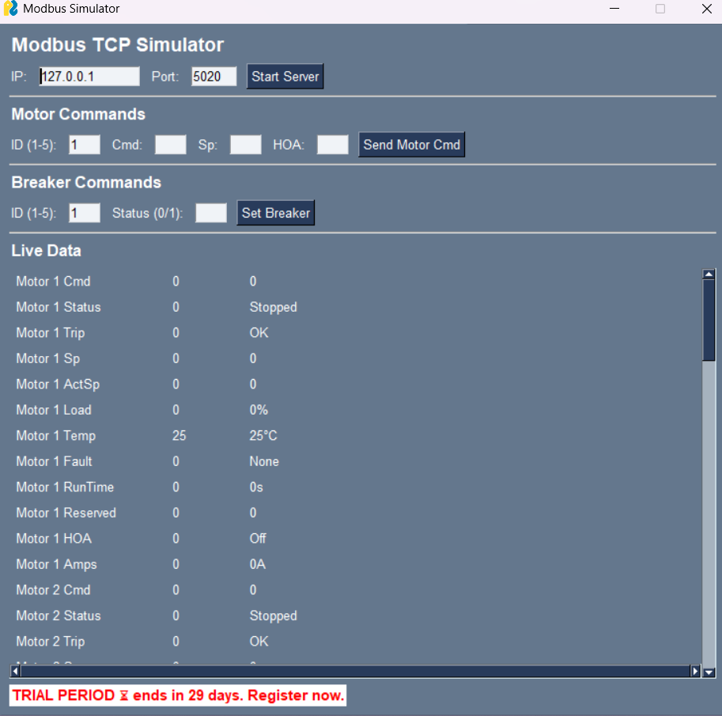
  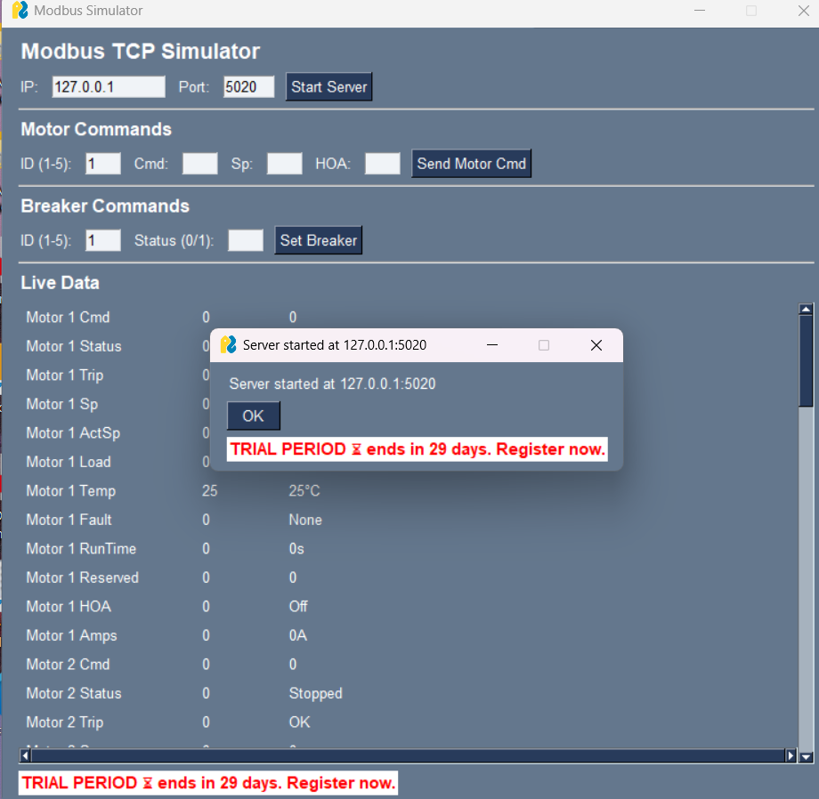
  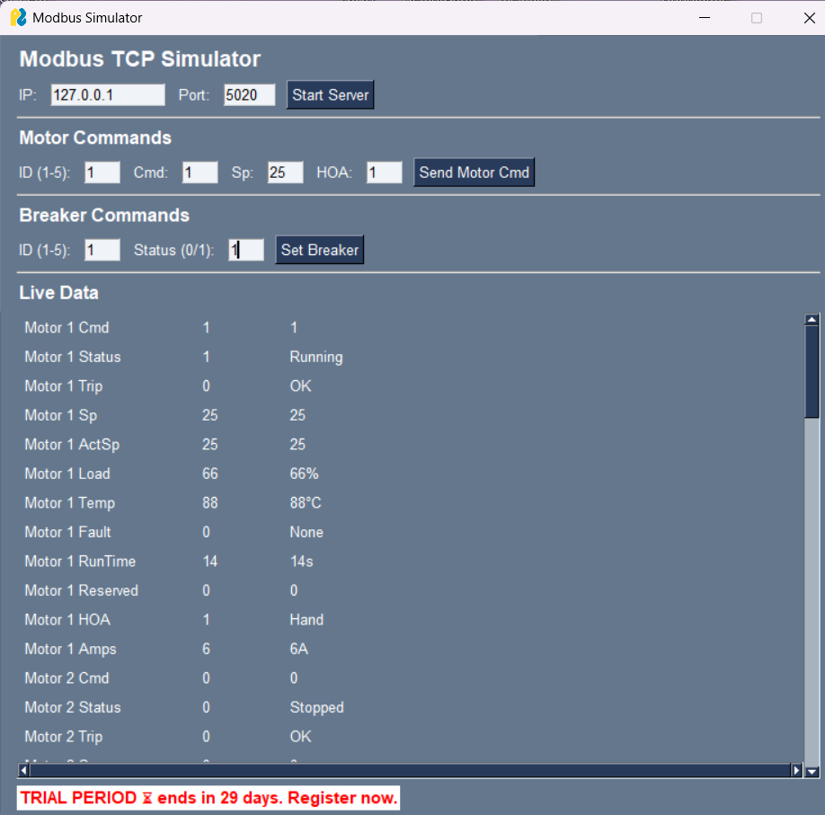
</p>

These screenshots demonstrate the simulator in action:

- The TCP Modbus server is successfully launched and listening on the specified IP and port.
- After issuing a motor **command** (Cmd = 1, HOA = 1 or 2), the motor transitions to **Running**.
- Live updates are visible for:
  - Motor parameters like speed setpoint (Sp), actual speed (ActSp), load, temperature, and runtime.
  - Breaker electrical readings like **Status**, **Trip Count**, **Voltage**, and **Current**.
- GUI refreshes at 1-second intervals, simulating realistic Modbus traffic.

🔗 [View Simulator Source Code](modbus-simulator/Modbus_simulator.py)

## 🔌 Ignition Integration

This section showcases how the Modbus simulator integrates with Ignition using OPC UA.

### 🔧 Motor & Breaker Tags in Ignition

The simulator publishes motor and breaker data which is imported into Ignition using Modbus mapping. These tags are displayed in the OPC browser and update in real-time.

### 📸 Screenshots

<p align="center">
  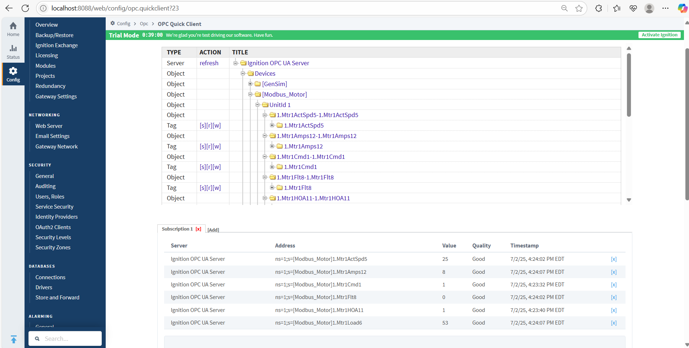
  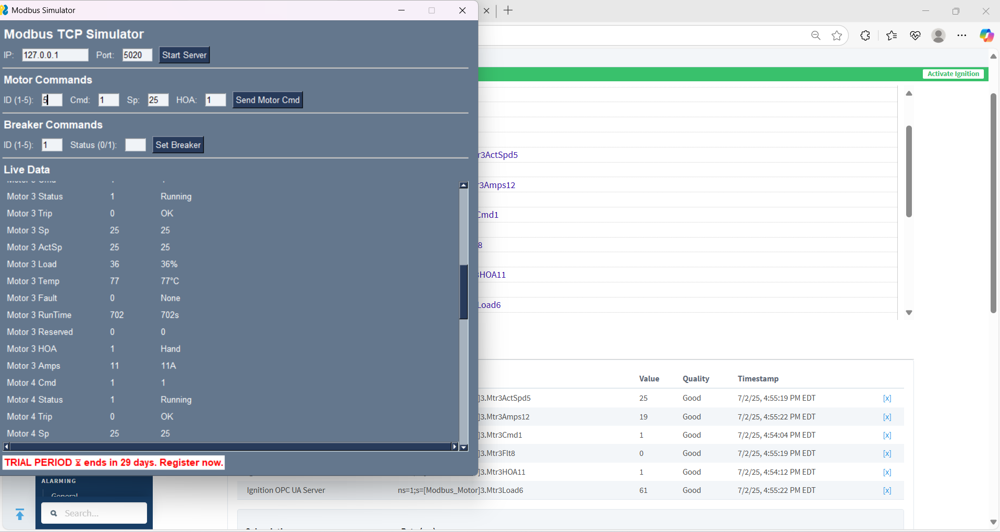
  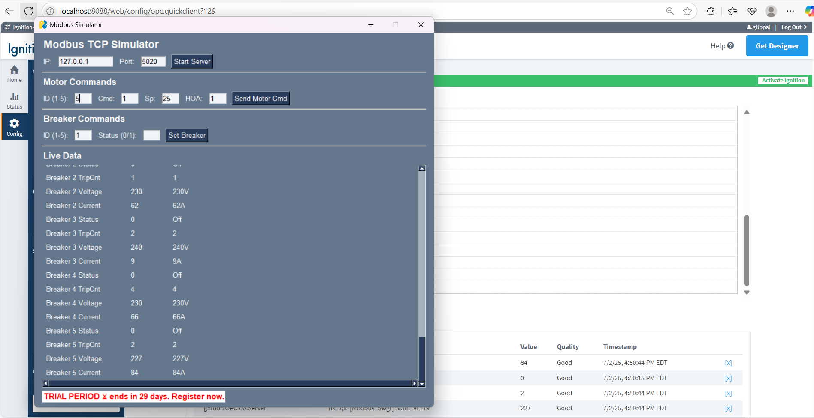
</p>

These screenshots show:

- OPC tag browser view with mapped Modbus addresses.
- Real-time values for motor commands, status, and process variables.
- Breaker electrical data including voltage, current, and trip count.

## 📂 Modbus Maps and Ignition Import

You can explore or download the Modbus register maps and corresponding Ignition import files directly from this repository:

- 🗂️ **Modbus Mapping CSVs** (used to configure the simulator):
  - [`Modbus_Motor_Map.csv`](modbus-maps/Modbus_Motor_Map.csv)
  - [`Modbus_Switchgear_Map.csv`](modbus-maps/Modbus_Switchgear_Map.csv)

- 📥 **Ignition Import-Ready CSVs**  
  (used to import tags through the **Ignition Gateway**):
  - [`Ignition-import-motors.csv`](modbus-maps/Ignition-import-motors.csv)
  - [`Ignition_Import_Switchgear_Breaker.csv`](modbus-maps/Ignition_Import_Switchgear_Breaker.csv)

> 📝 **Note:**  
> The Modbus map for the switchgear uses a **hexadecimal addressing scheme**, which is common in industrial PLC documentation.  
> However, **Ignition requires addresses in decimal format**, so make sure to convert all hexadecimal values to decimal before using them in Ignition.

## 🛠️ Ignition Designer Configuration

The Ignition Designer is used to visualize and configure the imported Modbus tags for both motors and switchgear devices.

These screenshots illustrate how the simulator data is brought to life within the Ignition Designer:

<p align="center">
  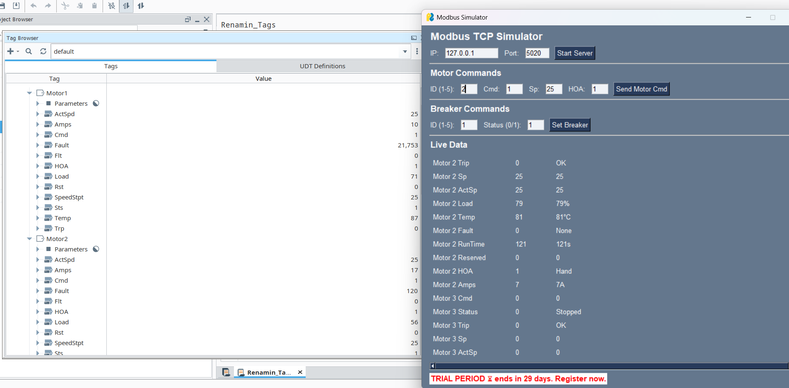
  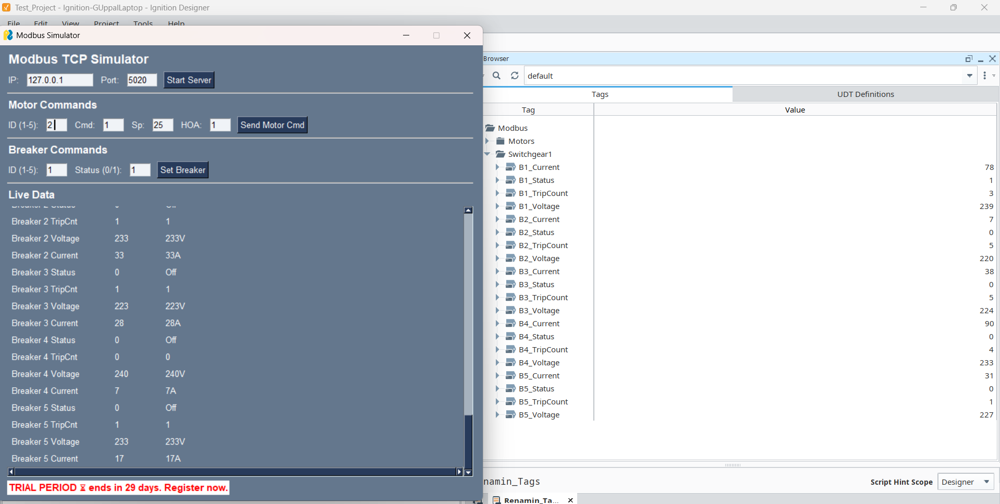
  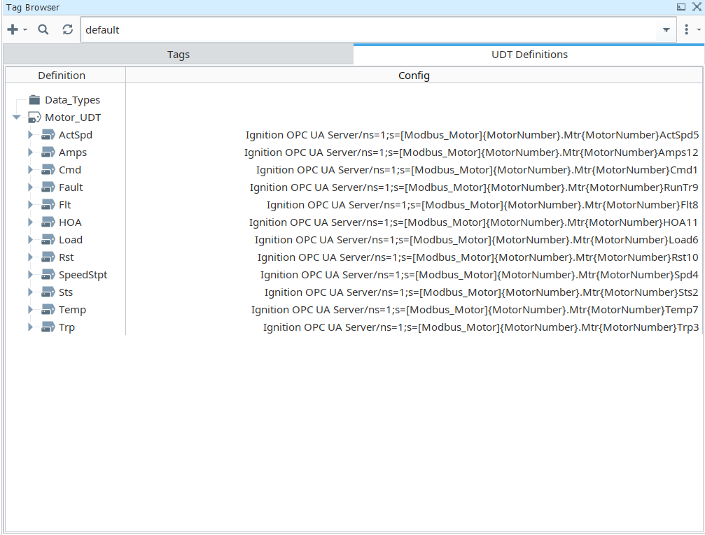
</p>

### Key Highlights:

- **Tag Hierarchy**: Motors and breakers are organized into folders for structured access.
- **Live Data Visualization**: Real-time values from the simulator are bound to components like labels and indicators.
- **UDT Implementation**: Motors and breakers are created as User Defined Types (UDTs) to standardize tag structures and simplify scaling.

These design elements help test Modbus tag behavior in a visual, scalable way inside Ignition.


## 🖥️ Motor Control UI with Ignition and Modbus TCP Simulator

This section shows how the Ignition Vision client is integrated with a custom Modbus TCP simulator to visualize and control motor status in real time.

### 🔴 Motor1 Stopped with Command Inputs

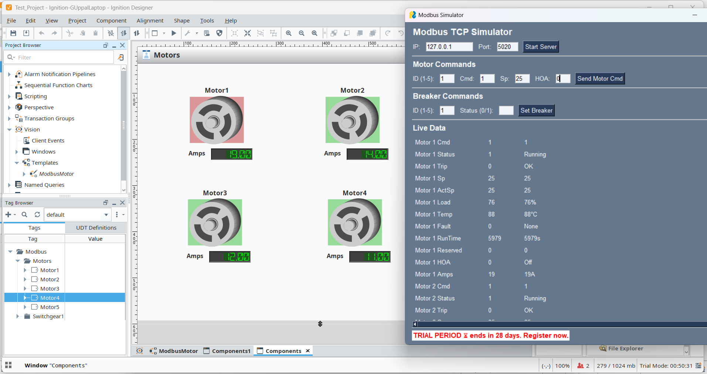

---

### 🔁 Mixed Motor States (Running, Stopped)

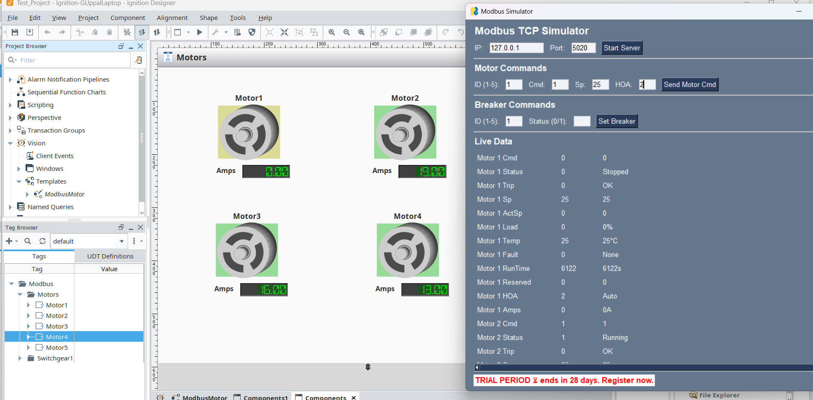

---

### 🟢 All Motors Running

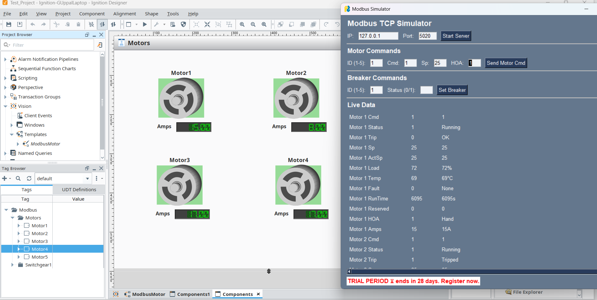

---

### 🔧 Description

- Each motor component reflects live Modbus tag values: Amps, Status, Trip, Fault, HOA, and more.
- A custom Modbus TCP simulator written in Python is used to send commands and simulate states.
- Ignition Vision provides live feedback and dynamic color changes to show current motor conditions.
- This setup demonstrates full-loop control simulation using Ignition and Modbus TCP.

---

## 🐍 Tkinter Simulator Implementation

In addition to the `PySimpleGUI` version, a revised simulator built entirely with Python's
standard-library **Tkinter** toolkit is available in
[`Modbus_simulator_rev.1.py`](modbus-simulator/Modbus_simulator_rev.1.py). Because Tkinter ships
with Python, this version runs without any additional GUI dependency and remains cross-platform.

### 📸 Screenshot

<p align="center">
  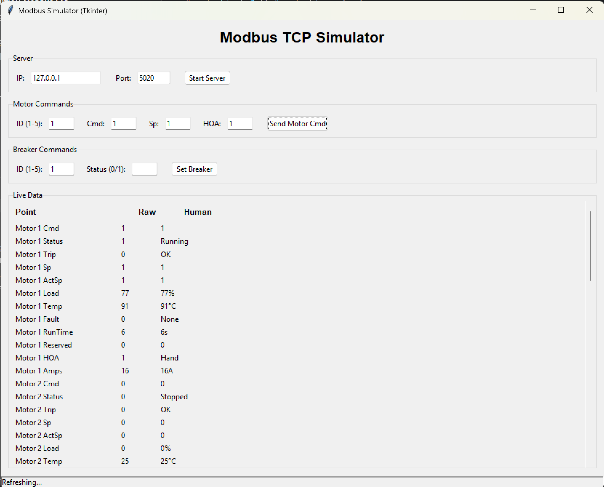
</p>

### Highlights

- **Server panel** – Configure the target **IP** and **Port** (default `127.0.0.1:5020`) and start
  the Modbus TCP server directly from the interface.
- **Motor Commands** – Select a motor by **ID (1–5)** and issue `Cmd`, `Sp` (setpoint), and `HOA`
  values with a single **Send Motor Cmd** button.
- **Breaker Commands** – Set any breaker **ID (1–5)** to a **Status (0/1)** using **Set Breaker**.
- **Live Data table** – A continuously refreshing view that shows each point's **Raw** register
  value alongside a **Human**-readable interpretation (e.g. `Running`, `77%`, `91°C`, `Hand`).
- **No extra dependencies** – Uses only `tkinter` and `pymodbus`, with compatibility shims for both
  pymodbus 2.x and 3.x APIs.

The screenshot above shows Motor 1 running (Cmd = 1, HOA = Hand) with live load, temperature, amps,
and runtime values updating in real time while Motor 2 remains stopped.

---

## 💾 Ignition Backup

A ready-made Ignition gateway backup is included in
[`Ignition-Project/Ignition-backups/`](Ignition-Project/Ignition-backups/) so you can reproduce the
reference setup instead of building it from scratch. Restore the `.gwbk` from the Ignition Gateway
web interface (**Config → System → Backup/Restore → Restore**). After restoring, sign in to the
gateway with:

| Field    | Value     |
| -------- | --------- |
| Username | `gUppal`  |
| Password | `1234567` |

> 📝 **Note:** These are demo credentials for a local test gateway only. Change them before exposing
> the gateway on any shared or production network.

After importing the CSV files, each tag is mapped to its Modbus register from the Ignition Gateway
under **Config → OPC UA → Device Connections → Addresses**. The screenshot below shows the motor
addresses configured in Ignition, listing the **Prefix**, **Start/End** register range, **Step**,
**Unit ID**, **Modbus Type** (Holding Register / Int16), and the resulting **Modbus Address** for
each point.

<p align="center">
  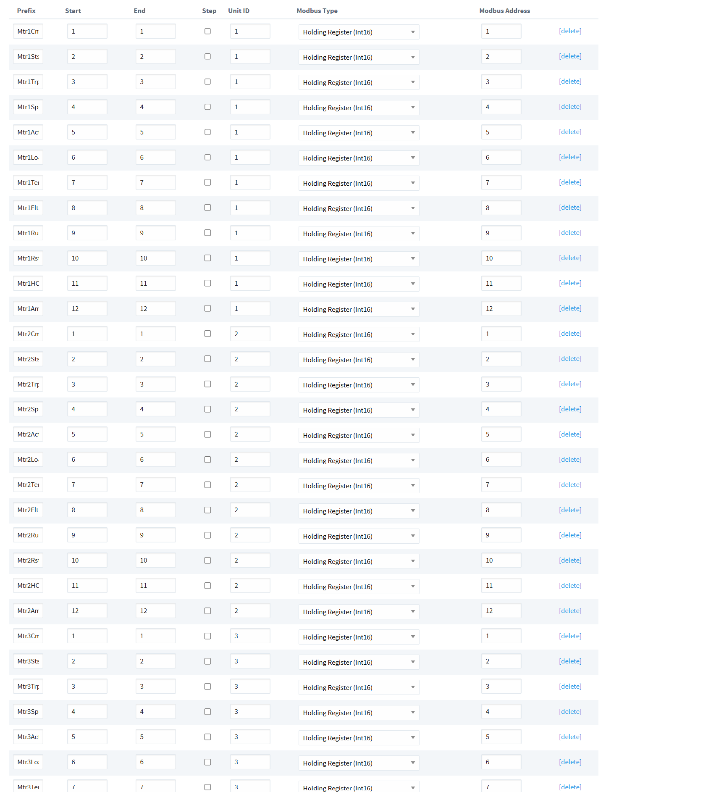
</p>
